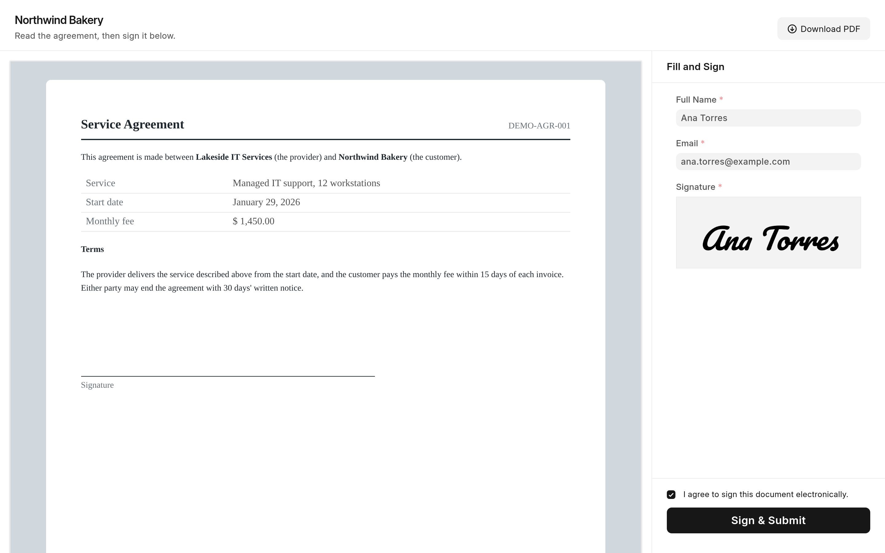
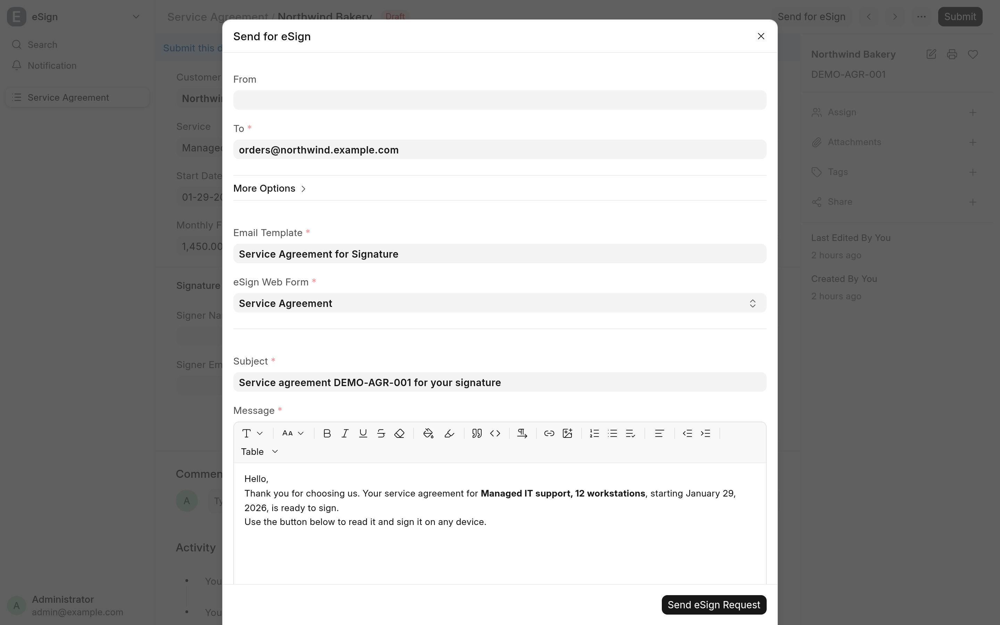
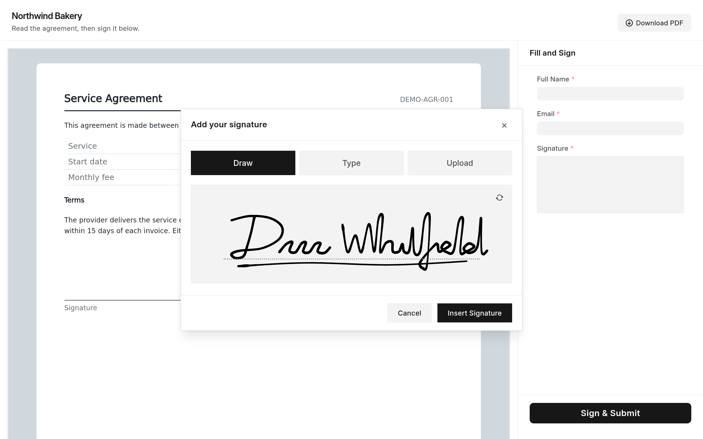

Quotes, orders, waivers and agreements often need a customer's signature before work can start. eSign Web Forms collects that signature inside Frappe instead of printing, scanning or paying for a separate e-signature service. You send the signer a link from the document, they read the document in its print format and sign it on their phone or computer without logging in, and the signed PDF comes back to the document with a record of who signed and when.

It is for teams that keep their documents in Frappe or ERPNext and want them signed where they live. It works with any DocType, standard or custom, that has a Signature field, and it has no DocTypes of its own: it adds eSign settings to **Web Form** and **Email Template**. It runs on Frappe v16 and is free software under the [MIT license](../license.txt).

## What you get

### A signing page for any DocType

Tick **Enable eSign** on a web form and its edit page becomes a signing page: the document in its print format on one side, the web form's fields, a consent checkbox and the submit button on the other. See [Set up a signing web form](signing-form.md).

### Send for eSign from the document

Documents whose DocType has a published eSign web form get a **Send for eSign** button. Its dialog sends the signing link by email with an eSign email template, and records the message on the document. See [Send a document for signature](send-for-esign.md).

### Draw, type or upload a signature

The app replaces Frappe's Signature control, in the desk and on the signing page, with a dialog that offers a drawing pad, a typed signature in one of four bundled script fonts, or an uploaded image. See [Sign a document](signing.md).

### Signed PDFs and an audit trail

After signing, the document is rendered in the web form's print format, attached as a private PDF with its SHA-256 hash, and an eSign card in the timeline records the signer, their email, the consent they gave, their IP address and browser, and the time. A web form can also set a field, submit the document and send a notification with the signed PDF attached. See [Signed PDFs and the audit trail](audit-trail.md).

### Recipient-bound links

A link emailed to one recipient carries a signed binding of their address, so the audit trail records the email as verified. **Require Verified Email** makes a web form sign only through such links. See [Verified email](verified-email.md).

## Where to start

| You are                                   | Read                                                                                                               |
| ----------------------------------------- | ------------------------------------------------------------------------------------------------------------------ |
| A signer who received a link              | [Sign a document](signing.md)                                                                                      |
| Staff sending documents for signature     | [Send a document for signature](send-for-esign.md), then [Signed PDFs and the audit trail](audit-trail.md)         |
| The administrator setting it up           | [Install and upgrade](install.md), [Set up a signing web form](signing-form.md), [Configuration](configuration.md) |
| Anyone deciding how far to trust a record | [Verified email](verified-email.md) and [Limitations and troubleshooting](troubleshooting.md)                      |
| A developer changing the app              | [Development](development/README.md) and [How it works](development/architecture.md)                               |

## Requirements

- A bench with Frappe v16. The app declares `frappe >=16.0.0,<17.0.0` and needs no other app.
- Background workers on the bench. The signed PDF and the timeline entry are written by jobs on the `short` queue.
- An outgoing **Email Account** to send signing requests from the desk.
- Optional: ERPNext, whose **Company** field on Email Account lets the dialog offer only the document's company accounts, and the cloud_storage app, which the app detects and supports for the signed PDFs.

> [!NOTE]
> These pages describe the code in the repository. Where a statement depends on Frappe's own behavior, the page says so; it was checked against Frappe 16.52.

## Source and changes

The source is at [github.com/Avunu/esign_webforms](https://github.com/Avunu/esign_webforms). Releases and their notes are on the [GitHub releases page](https://github.com/Avunu/esign_webforms/releases).
