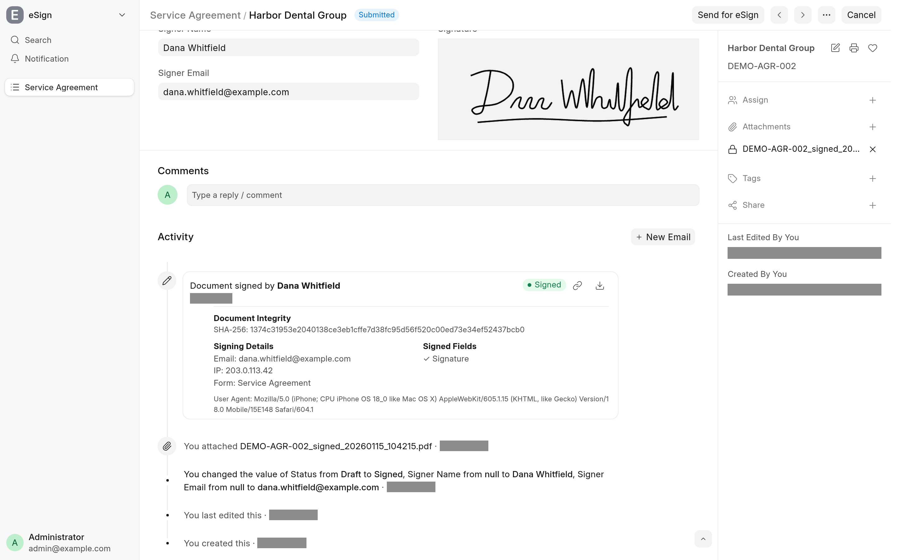

Signing saves the signer's fields on the document straight away. The signed PDF and the record of the signing follow a few seconds later, written by two background jobs. This page describes what they produce and where to find it.

## What happens when a document is signed

In one save, the app:

1. Writes the fields the signer filled in. With **Require Verified Email**, the email field gets the address the link was bound to, whatever the form sent.
2. Sets the web form's **Set Property After Response** field to its **Value To Be Set**, if one is configured.
3. Submits the document, if **Submit on Response** is ticked, the DocType is submittable and the document is a draft.

After that save is committed, a job on the `short` queue renders the document in the print format of the signing link (the web form's **Print Format** unless the link names another) and attaches it to the document as a private file named after the document and the time, `<DOCUMENT>_signed_<YYYYMMDD>_<HHMMSS>.pdf` (Frappe drops spaces and turns `/` into `-`), with its SHA-256 hash. A second job then writes the audit record and sends the notification.

## The timeline card

Each signing adds an eSign card to the document's timeline: "Document signed by" the signer, with a **Signed** badge and buttons to open and download the signed PDF.

| On the card            | Where it comes from                                                                                                                                                                             |
| ---------------------- | ----------------------------------------------------------------------------------------------------------------------------------------------------------------------------------------------- |
| Signer's name          | What they typed into the **Signer Name Field**. Without that setting, a signed-in user signing as themselves is named after their own User; anyone else is not named.                           |
| **Document Integrity** | The SHA-256 hash of the signed PDF.                                                                                                                                                             |
| **Email**              | See [Which email is recorded](#which-email-is-recorded).                                                                                                                                        |
| Verification           | "Email verified via recipient link", or "Link sent to …, verified via recipient link" when the signer entered another address in the **Signer Email Field** than the one the link was bound to. |
| **IP**                 | The signer's IP address, from the `CF-Connecting-IP`, `X-Real-IP` or `X-Forwarded-For` header, or else the connection.                                                                          |
| **Form**               | The web form's title.                                                                                                                                                                           |
| **Signed Fields**      | The Signature fields that hold a signature.                                                                                                                                                     |
| **Consent**            | The consent text the signer ticked, and when the server received it.                                                                                                                            |
| **User Agent**         | The signer's browser.                                                                                                                                                                           |

The card is drawn from an eSign Communication on the document. Its content holds the same data as JSON, with the signing time, the print format and the PDF's file name too; its sender and sender name are the signer's email and name. The Communication has its own copy of the signed PDF.

## Which email is recorded

The app takes the first of these that applies:

1. With **Require Verified Email**, the address the link was bound to, and nothing else.
2. With a **Signer Email Field**, the valid address the signer submitted in it. The link's address only pre-fills the field.
3. Otherwise, the link's address, then a Data field with the options `Email` on the form.
4. Failing those, the signed-in user's login.

The email is recorded as verified when it is the address the link was bound to. See [Verified email](verified-email.md).

## The notification email

With **Send Notification on Response** and a **Notification** set on the web form, the second job sends that Notification's email, rendered as Frappe renders it, with two changes: the signed PDF is attached instead of a fresh print, and an **eSign Audit Trail** table is added at the end of the message with the signer, email, verification, consent, signing time, IP address, user agent, signed fields and **PDF SHA-256**. The email is recorded on the document as a Communication. If the Notification sets a property after the alert, that is applied too.

The Notification must be enabled, belong to the web form's DocType, and have **Send Alert On** Custom and **Channel** Email. Any other is skipped and an entry is written to the Error Log: see [Troubleshooting](troubleshooting.md#the-notification-is-not-sent).

## Get the signed PDF

- **In the desk:** the PDF is in the document's attachments, and the open and download buttons on the timeline card.
- **On the signing page:** the signer, or anyone with the link, sees it under **Document Signed** and can download it with **Download Signed Document**. Each download through the page is written to the Access Log.

When a document has been signed more than once, the page serves the most recent signed PDF.

## With cloud_storage

When the cloud_storage app is installed, the signed PDF is stored once: the eSign Communication gets an association to the same file instead of a copy. Guests download it through a cloud_storage sharing link, which the app creates on the first download.
