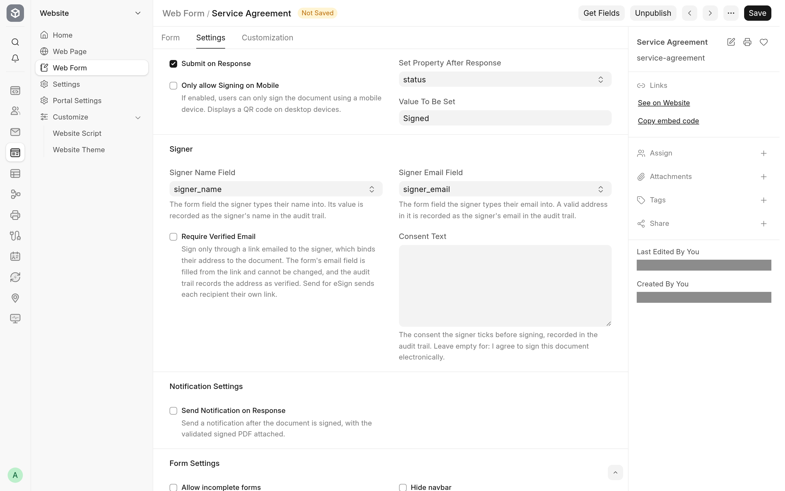

A document is signed through a web form of its DocType. This page walks through the one-time set-up for a DocType: the Signature field, the eSign web form and an email template. Every setting is described in [Configuration](configuration.md).

## Prepare the DocType

1. Give the DocType you want signed a field of type **Signature**. To change the words the signature dialog uses, put them in the field's **Options**: `Initials` makes the dialog say "Add your initials" instead of "Add your signature".
2. Add the fields the signer should fill in, if the DocType does not have them yet. For a signer without an account, add a Data field for their name and a Data field for their email, with the options `Email`.
3. To sign documents that are already submitted, tick **Allow on Submit** on the Signature field and on every other field the web form changes. Frappe refuses to change any other field of a submitted document.

## Create the web form

1. Create a **Web Form**, set **Select DocType** to your DocType and tick **Published**.
2. Tick **Enable eSign**. The **Print Format** field and the **eSign Settings**, **Signer** and **Notification Settings** sections appear.
3. Add the Signature field to the web form's fields, and any field the signer fills in, such as their name and email. Make a field mandatory on the web form if every signer must fill it.
4. Pick the **Print Format** the signer reads and the signed PDF is made from. Left empty, Frappe's standard format is used.
5. In **eSign Settings**, choose what happens when the document is signed:
   - **Submit on Response** submits a submittable document.
   - **Set Property After Response** and **Value To Be Set** set a Select, Link, Data or Text field, for example **Status** to `Signed`.
   - **Only allow Signing on Mobile** sends desktop signers to their phone with a QR code.
6. In **Signer**, name the fields the audit trail records:
   - **Signer Name Field**: the form field the signer types their name into.
   - **Signer Email Field**: the form field the signer types their email into.
   - **Require Verified Email**: tick it to sign only through a link emailed to each signer. Read [Verified email](verified-email.md) first.
   - **Consent Text**: replaces "I agree to sign this document electronically." if you need other wording.

   

7. Optionally, in **Notification Settings**, tick **Send Notification on Response** and pick a **Notification**. Create the Notification first: same **Document Type** as the web form, **Send Alert On** set to Custom, **Channel** Email, and **Enabled** ticked. Its recipients get the signed PDF and the audit trail.
8. Save. Saving ticks **Allow editing after submit** for you, and refuses a **Set Property After Response**, **Signer Name Field** or **Signer Email Field** the app cannot use.

The web form's own **Introduction**, **Submit button label**, **Success title**, **Success message** and **Success URL** shape the signing page too: see [Configuration](configuration.md#web-form).

> [!TIP]
> The **Signer Name Field** and **Signer Email Field** lists offer the web form's Data fields. If you have just added a field with **Get Fields**, open the list again to see it.

## Create the email template

1. Create an **Email Template** and tick **eSign Request**.
2. Write the **Subject** and the **Response**. Frappe renders both with the document's fields as the context, so `{{ name }}` and the document's other fields work. The dialog fills them in when the template is picked, and the sender can still edit them.
3. You do not need to put the link in the message. When the message does not contain it, the email gets a **Sign Document** button. To place the link yourself, see [Links in your own templates](send-for-esign.md#links-in-your-own-templates).

## Check it

1. Make sure an outgoing **Email Account** exists and the bench's workers are running.
2. Open a saved document of the DocType. **Send for eSign** appears among the form's buttons.
3. Send a request to yourself, open the link in a private window, and sign. Within a few seconds the document's timeline shows the eSign card and the signed PDF is attached. See [Signed PDFs and the audit trail](audit-trail.md).
